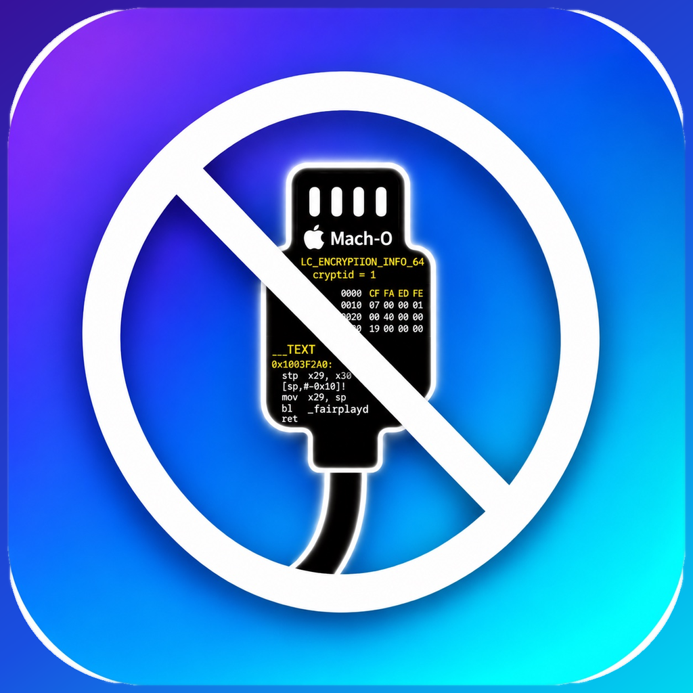

<!-- Brand: Tetherless · https://tetherless.dev -->
<pre align="center">
_____           _     _                     _
|_   _|  ___   | |_  | |__    ___    _ __  | |  ___    ___   ___
  | |   / _ \  | __| | '_ \  / _ \  | '__| | | / _ \  / __| / __|
  | |   |  __/ | |_  | | | | |  __/ | |    | | |  __/ \__ \ \__ \
  |_|   \___|   \__| |_| |_| \___|  |_|    |_| \___|  |___/ |___/
</pre>

<p align="center">
  
</p>

<h1 align="center">Tetherless</h1>

<p align="center">
  <strong>On-device sideloading — pair, sign, install. No computer required.</strong><br />
  <a href="https://tetherless.dev">tetherless.dev</a>
  · Bundle ID <code>dev.tetherless.app</code>
  · v3.7
</p>

---

## Look & feel

Tetherless ships a glassmorphism shell over the existing signing and install stack:

- **Purple → teal** full-bleed gradient background
- **Glass cards** and capsule controls with soft material blur
- **Floating tab bar** — Search · Downloads · Purchased · Account. Pair / Files / Library live under Account.
- Gradient **app icon** (no-cable mark) matching the UI palette

Backends (TrustCore signing, OTA, native install) are unchanged under the new chrome.

## Features

- **Sign & install any IPA** — using your free Apple ID, or your own certificate.
- **Get a clean copy of apps you own** — FairPlay decrypt on this iPhone (Installed or Store). App Store search + login are built in (includes GPL-2.0 open-source Store login code). Optional Telegram Phone Worker.
- **Multiple App Store accounts** — sign several Apple IDs in for downloads and switch between them from Search or Account.
- **Tweak injection** — add `.deb` or `.dylib` tweaks while you sign.
- **Keep apps alive** — resign in one tap, Refresh All at once, or automate it with a Shortcut so your apps (and Tetherless itself) never expire — even while your iPhone is locked.
- **Built-in Files** — manage IPAs, tweaks, and downloads without leaving the app.
- **Custom certificate mode** — bring your own paid certificate to install over the air, with no pairing or VPN.
- **Manage your Apple ID** — view your signing certificates, App IDs, and devices from Apple’s Developer services, and revoke a certificate to free a free-tier slot — in the app.

| Area | What you get |
| --- | --- |
| **Search** | App Store search → App Detail / Get → Downloads (or FairPlay decrypt) |
| **Downloads** | Real download manager — pause / resume / progress / Install / Retry / Edit |
| **Purchased** | Purchase history with dates, Select, cloud redownload, App Detail |
| **Account** | Apple ID, Installation settings (One-tap / Native / Certificate / Proxy), Pair, Files, Library, Settings |

**Decrypt tip:** Prefer **Account › Installed & sources → Decrypt**, or **Purchased**. **App Store search** is on by default (Settings) for name / App ID / store-link / multi-region / delisted lookup plus Timbrd·Bilin·iosdump version history. **Telegram / Phone Worker** remains optional.
| **Sign & install** | TrustCore signing, OTA via `*.tetherless.dev`, or native idevice install |
| **Analysis** | Local Analysis Center — disassembler, CFG, pseudocode, reversible patch proposals |
| **Identity** | ADID (`AS-XXXXXX-XX`) minted on first launch, stored in Keychain |

### Install paths

1. **OTA (default)** — `itms-services` over the tetherless.dev loopback HTTPS host  
2. **Native** — built-in local VPN + device pairing (Settings › Install Method)

### On-device OTA (`tetherless.dev`)

1. DNS: `*.tetherless.dev` → `127.0.0.1` (apex hosts `pack.json` on the VPS)
2. Generate & deploy the pack — see [`server/ota/tetherless-ota.md`](server/ota/tetherless-ota.md)
3. App pulls the pack on launch; enable **Full Trust** for the pack CA once

Native install details: [`NATIVE_INSTALL.md`](NATIVE_INSTALL.md)

## Build

```bash
xcodebuild -project ./Tetherless.xcodeproj -scheme Tetherless -configuration Release -sdk iphoneos clean archive
```

## ADID identity

New installations mint a cryptographically random `AS-XXXXXX-XX` ADID on first use. The ID is stored in Keychain and is not derived from hardware or display fingerprints.

Administrators can reassign the ADID of their authenticated admin account from Settings → Account. The app calls `account.php` with `action=admin_set_mdid`; the server must atomically update the account ADID and its ADID-based role mapping before returning the canonical ADID. Tetherless only changes its local Keychain value after that server response.

See [`MDID_IDENTITY.md`](MDID_IDENTITY.md) for the API contract.

## Local Analysis Center

The analysis stack is local-first — no remote analysis service. The same annotated `UCFunction` feeds the Disassembler Browser, CFG Viewer, Pseudocode Viewer, and Analysis Center.

Analysis Center exposes:

- Overview / local analysis statistics
- String annotations
- Resolved symbols / classes / methods
- Function / call inspection
- Basic-block graph edges
- Call / branch / XREF flow
- Hex / memory view of decoded function bytes
- Reversible local NOP/RET patch proposals and patch manifest export
- Original-vs-proposed patch diff
- One-tap navigation back to Disassembler, CFG, and Pseudocode

Patch proposals stay as an in-memory / local manifest in the viewer; opening the analysis UI does not modify the source binary.

## Links

- Site: [tetherless.dev](https://tetherless.dev)
- OTA pack docs: [`server/ota/tetherless-ota.md`](server/ota/tetherless-ota.md)
- Native install: [`NATIVE_INSTALL.md`](NATIVE_INSTALL.md)
- ADID / MDID: [`MDID_IDENTITY.md`](MDID_IDENTITY.md)
